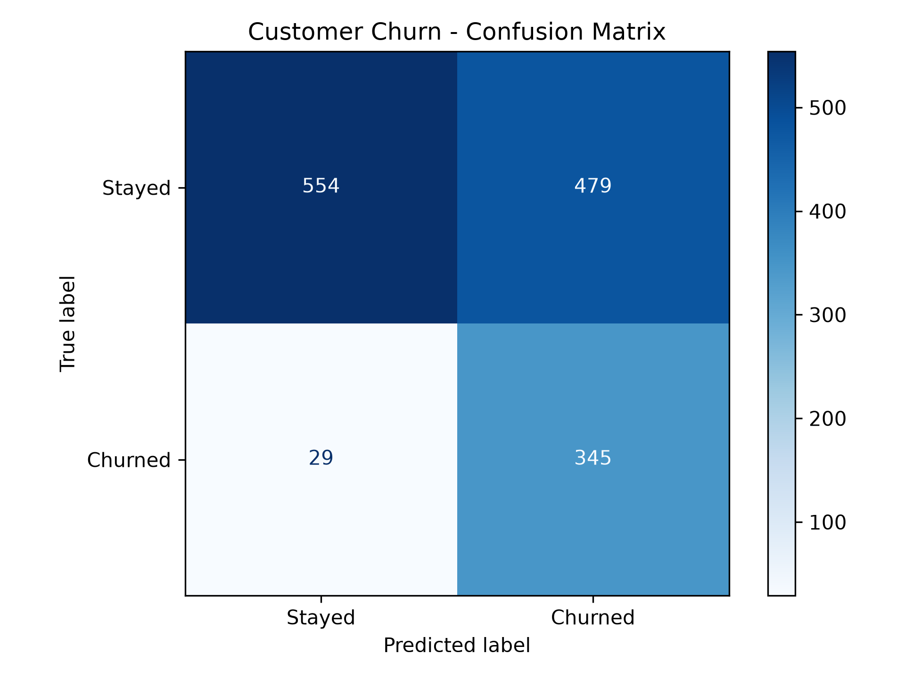
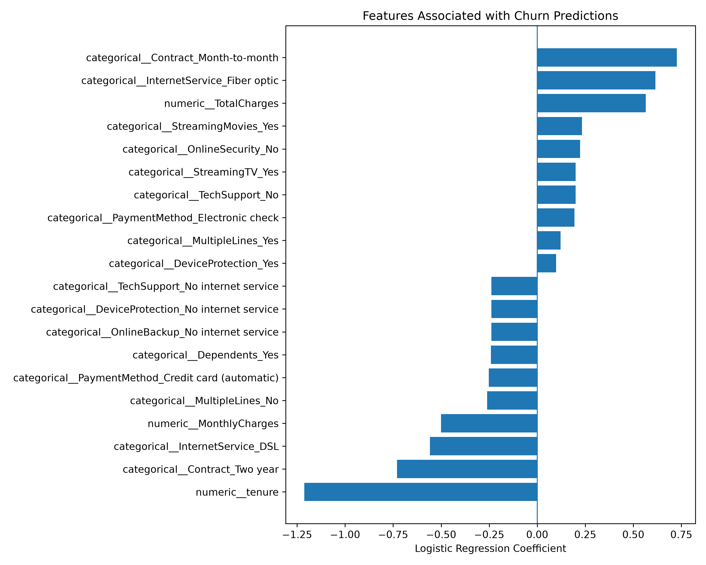

# Customer Churn Prediction using Machine Learning

## 🚀 Live Demo

Try the application here: [Customer Churn Prediction App](https://customer-churn-prediction-csqj96dngmlavnwust3gsg.streamlit.app/)

Enter customer details to estimate churn probability and explore how customer characteristics affect predictions.

## Project Overview

A machine learning project that predicts whether a telecom customer is likely to leave the service. It uses customer demographics, account information, subscription details, and service usage attributes to estimate churn probability.

The project includes an interactive Streamlit application, model comparison experiments, and a REST API built with FastAPI and packaged using Docker.

## Business Problem

Customer churn affects recurring revenue and customer retention. This project aims to identify customers at risk of leaving so businesses can consider targeted retention strategies.

## Dataset

- IBM Telco Customer Churn dataset.
- Includes customer demographics, services, contract details, billing information, and churn labels.
- Rows with missing `TotalCharges` values are removed during data cleaning.

## Tech Stack

- **Language:** Python
- **Data Processing:** Pandas, NumPy
- **Machine Learning:** Scikit-learn, Logistic Regression, Random Forest
- **Deep Learning:** PyTorch
- **API:** FastAPI, Pydantic, Uvicorn
- **Visualization:** Matplotlib, Seaborn
- **Model Persistence:** Joblib
- **Deployment:** Docker
- **Interactive UI:** Streamlit

## Project Workflow

1. Clean the dataset and perform exploratory data analysis.
2. Separate features and target labels.
3. Create stratified training, validation, and test splits.
4. Scale numerical features and encode categorical features using a preprocessing pipeline.
5. Train a class-weighted Logistic Regression baseline.
6. Train and compare a Random Forest classifier using validation metrics.
7. Experiment with a PyTorch feed-forward neural network using class-weighted loss and early stopping.
8. Compare model precision, recall, and F1-score at a classification threshold of `0.30`.
9. Evaluate the selected Scikit-learn model on the held-out test set.
10. Expose predictions through a FastAPI REST API.
11. Package the API and trained model in a Docker container.

## Model Comparison

Models were compared using the same stratified training and validation split. Precision, recall, and F1-score were calculated using a classification threshold of `0.30`.

### Validation Results

| Model | Precision | Recall | F1-score |
|---|---:|---:|---:|
| Logistic Regression | 43.1% | 91.2% | 58.5% |
| Random Forest | 45.7% | 87.2% | 59.9% |
| PyTorch Neural Network | 43.9% | 88.2% | 58.7% |

Random Forest achieved the highest validation F1-score among these experiments. Logistic Regression achieved higher validation recall, making it a useful baseline when identifying as many potential churners as possible is the priority.

### Selected Model: Random Forest

Random Forest was selected based on its validation F1-score. Its final test results were:

| Metric | Test Result |
|---|---:|
| Precision | 43.2% |
| Recall | 87.2% |
| F1-score | 57.8% |
| Accuracy | 66.0% |

The test set contained 374 customers who churned. At the selected threshold, the Random Forest model identified approximately 326 of them.

For comparison, the existing Logistic Regression baseline achieved 41.9% precision, 92.2% recall, and a 57.6% F1-score on the test set.

Random Forest provided a small improvement in test F1-score and precision, while Logistic Regression retained higher recall. These results illustrate the trade-off between identifying more potential churners and reducing false-positive predictions. The small test F1-score difference should not be interpreted as evidence of a substantial performance improvement.

The PyTorch neural network was evaluated on the validation set; its reported metrics are not test-set results.

These experiments are based on a single dataset split and do not guarantee real-world performance.

## API Endpoints

The FastAPI application exposes the following endpoints:

| Method | Endpoint | Description |
|---|---|---|
| GET | `/` | Returns an API welcome message |
| GET | `/health` | Reports API health and model loading status |
| POST | `/predict` | Returns churn probability and a threshold-based prediction |

### Example Prediction Request

Send a `POST` request to `/predict` with customer features:

```json
{
  "gender": "Female",
  "SeniorCitizen": 0,
  "Partner": "No",
  "Dependents": "No",
  "tenure": 2,
  "PhoneService": "Yes",
  "MultipleLines": "No",
  "PaperlessBilling": "Yes",
  "InternetService": "Fiber optic",
  "OnlineSecurity": "No",
  "OnlineBackup": "No",
  "DeviceProtection": "No",
  "TechSupport": "No",
  "StreamingTV": "No",
  "StreamingMovies": "No",
  "Contract": "Month-to-month",
  "PaymentMethod": "Electronic check",
  "MonthlyCharges": 70.0,
  "TotalCharges": 140.0
}
```

Example response from a previously tested request:

```json
{
  "churn_probability": 0.8471,
  "prediction": 1,
  "result": "Likely to churn",
  "threshold": 0.3
}
```

The example probability is illustrative. `prediction: 1` indicates likely churn under the configured threshold.

**Note:** The Docker API currently loads the saved `churn_model.joblib` file. If you change the model used by the API, retrain or save the intended model and rebuild the Docker image before deploying the updated version.

## Run the Project Locally

### 1. Clone the repository

```bash
git clone https://github.com/NEH073/customer-churn-prediction.git
cd customer-churn-prediction
```

### 2. Install dependencies

```bash
python -m pip install -r requirements.txt
```

Activate your virtual environment first if you use one.

### 3. Add the dataset

Place the IBM Telco Customer Churn dataset in the project root and name it `churn.csv`.

### 4. Train the Logistic Regression baseline

```bash
python train.py
```

### 5. Compare Logistic Regression and Random Forest

```bash
python compare_models.py
```

This script compares the models using validation metrics and evaluates the selected model on the held-out test set.

### 6. Run the PyTorch experiment

```bash
python train_pytorch.py
```

The PyTorch script trains a feed-forward neural network and reports validation metrics. Install PyTorch in your Python environment if it is not already installed.

### 7. Launch the Streamlit application

```bash
python -m streamlit run app.py
```

### 8. Run the FastAPI application

Ensure `churn_model.joblib` exists, then run:

```bash
python -m uvicorn api:app --reload
```

Open the interactive API documentation at [http://127.0.0.1:8000/docs](http://127.0.0.1:8000/docs).

## Run with Docker

Ensure Docker Desktop is running and the trained `churn_model.joblib` file is present.

### 1. Build the image

```bash
docker build -t customer-churn-api .
```

### 2. Start the container

Port `8001` is used to avoid conflicts with other applications that may use port `8000`.

```bash
docker run --name customer-churn-container -p 8001:8000 customer-churn-api
```

### 3. Test the API

- Health endpoint: [http://127.0.0.1:8001/health](http://127.0.0.1:8001/health)
- Interactive API documentation: [http://127.0.0.1:8001/docs](http://127.0.0.1:8001/docs)

Use `POST /predict` in the interactive documentation to submit customer details and receive a prediction.

To stop the running container, press `Ctrl + C`. To remove the stopped container later, run:

```bash
docker rm customer-churn-container
```

## Model Evaluation Visualizations

### Confusion Matrix

The confusion matrix illustrates the classification results of the existing Logistic Regression baseline, including correctly identified churners and false-positive predictions.



### Feature Coefficients

This chart displays the strongest positive and negative Logistic Regression coefficients. Positive coefficients push predictions toward churn, while negative coefficients push predictions toward staying. These associations do not establish causation.



## Future Improvements

- Tune classification thresholds and compare precision-recall trade-offs.
- Perform hyperparameter tuning and cross-validation.
- Add automated tests for API validation and prediction behavior.
- Add model monitoring and prediction logging.
- Explore model versioning and automated deployment workflows.
- Evaluate the selected model on additional data to assess generalization.
